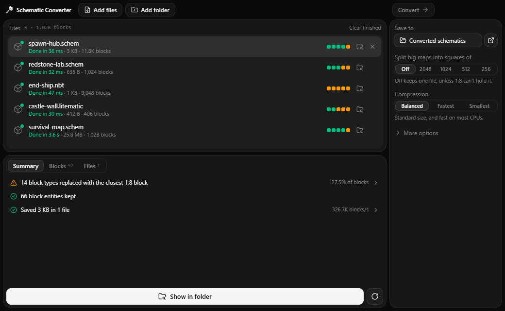

# Schematic Converter

Convert modern Minecraft schematics to 1.8.8, including maps with billions of blocks. A desktop app that runs entirely on your computer.



## Download

Get the latest version from [Releases](https://github.com/okiwiziin/schematic-converter/releases/latest):

- **Setup** installs the app and adds it to the Start menu.
- **Portable** is a single file that runs without installing anything.

Windows 10 and 11, 64-bit. The app isn't code signed yet, so Windows SmartScreen may warn you the first time. Choose **More info**, then **Run anyway**.

## How to use it

1. Drop your files or a whole folder onto the window.
2. Press **Convert**.
3. Press **Show in folder**, and copy the `.schematic` into `plugins/WorldEdit/schematics/` on your 1.8.8 server.

Then `//schem load name` and `//paste` in game. Your original paste position is kept where the source file has one.

## What it reads

| Format | Made by |
| --- | --- |
| `.schem` versions 1, 2 and 3 | WorldEdit, FastAsyncWorldEdit, Sponge |
| `.litematic`, including several regions | Litematica |
| `.nbt` | Structure blocks, up to the new format in Minecraft 26.4 |
| `.schematic` | Older tools, with 1.9 to 1.12 blocks mapped down |

## Big maps

Nothing loads whole files into memory. Blocks stream straight from the input through the converter to the output, and compression runs on every CPU core, so memory stays flat no matter how big the map is.

Measured on a 16-thread desktop with generated, map-like terrain:

| Map | Blocks | Time | Peak memory | Output |
| --- | --- | --- | --- | --- |
| 1000×256×1000 `.litematic` | 256 million | 1.6 s | 180 MB | 1 file |
| 2000×256×2000 `.schem` | 1.02 billion | 4.3 s | 192 MB | 1 file, 26 MB |
| 3000×256×3000 `.litematic` | 2.3 billion | 13.5 s | 241 MB | 4 files, split automatically |
| 500×256×500 `.schem` of pure random blocks, the worst case | 64 million | 1.9 s | 160 MB | 1 file, 12 MB |

A 1.8 `.schematic` can hold about 2.1 billion blocks and 32,767 per side, so anything larger splits by itself. You can also split on purpose, which is worth doing for big maps because WorldEdit on 1.8.8 loads a whole file into memory. Every piece remembers its place: stand on one spot, then load and `//paste` each piece there, and they line up.

You'll need free disk space in the output folder of about twice the final file size while converting.

## What gets converted

**Blocks.** Every block and block state from Minecraft 1.13 to the latest version has a mapping. Blocks that exist in 1.8 convert exactly, with their facing, half and so on. Newer ones become the closest 1.8 block with the same shape where possible: `cherry_stairs` becomes birch stairs, `red_concrete` becomes red stained clay. After converting, the **Blocks** tab shows every replacement, and the pencil lets you choose your own.

**Block entities.** Signs, chests and their items, furnaces, hoppers, heads with their textures, banners with their patterns, flower pots, note blocks, spawners, command blocks and more.

**Entities.** Armor stands, item frames, paintings, minecarts, boats and mobs that exist in 1.8.

**What doesn't survive.** Biomes aren't kept. Block entities with no 1.8 equivalent are dropped, such as shulker box contents and lecterns, and so are items, entities and paintings 1.8 doesn't have. The summary tells you when this happens. Blocks from mods have no mapping, so they use the block you choose under **More options**.

## Development

Requires Node.js 22 or newer.

```sh
npm install
npm run dev        # Run the app with hot reload
npm test           # Unit and conversion tests
npm run test:e2e   # Drive the real app with Playwright
npm run dist       # Build the Windows installer and portable app into dist/
```

A headless converter is built along with the app, which is useful for benchmarks:

```sh
npm run build
node scripts/make-big-schem.mjs big.schem 2000 256 2000
UV_THREADPOOL_SIZE=18 ELECTRON_RUN_AS_NODE=1 npx electron out/main/cli.js big.schem output/
```

### Optional tests

These need files that aren't in the repository, so they're skipped unless you point them at some:

- **`WORLDEDIT_JARS`**: a folder holding `worldedit-core-6.1.jar`, `guava-18.0.jar`, `gson-2.2.4.jar` and `jsr305-1.3.9.jar`. Converted files are loaded with WorldEdit's real `SchematicReader`, using `test/worldedit/Harness.java`. Needs a JDK.
- **`BIG_SCHEM` and `BIG_OUTPUT`**: a large `.schem` and the `.schematic` made from it, compared block by block using a separate, deliberately simple decoder.
- **`SAMPLE_SCHEMATIC`**: any real 1.8 `.schematic` with signs in it, which must come through unchanged.

See [AGENTS.md](AGENTS.md) for how the code is laid out.

## Licence

[MIT](LICENSE). The app includes and derives from other open source projects, listed in [THIRD_PARTY_NOTICES.md](THIRD_PARTY_NOTICES.md): its look comes from [T3 Code](https://t3.codes), and the block tables are generated from [minecraft-data](https://github.com/PrismarineJS/minecraft-data).

Not affiliated with Mojang or Microsoft.
